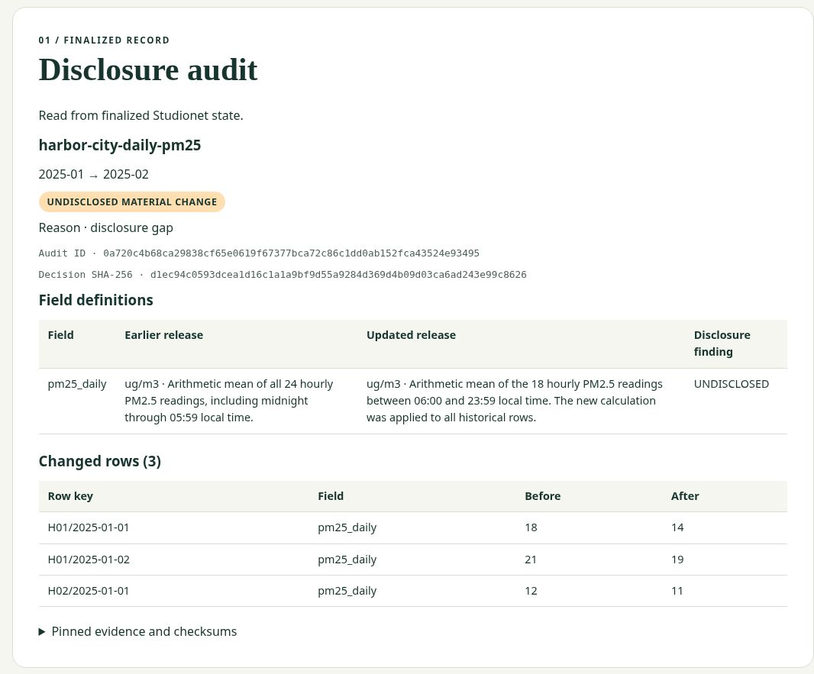

# Live verification

Open [ArchiveGap](https://archivegap.tinymule33.chatgpt.site/) and load both air-quality examples. The page reads the decision and exact changes from finalized Studionet state. The receipt tracker distinguishes consensus finalization from execution success.

| Item | Evidence |
| --- | --- |
| Network | GenLayer Studionet, chain ID 61999 |
| Deployed contract | [0x22F674e0005355AB289307d9A746c3E5b510ACbE](https://explorer-studio.genlayer.com/address/0x22F674e0005355AB289307d9A746c3E5b510ACbE) |
| Initial deployment | [Finalized receipt](https://explorer-studio.genlayer.com/tx/0x272c0e7f8fb3d34f69c780605ee95747ecce850f4fc6e11be2e3a2bc8182aec8) |
| In-place code upgrade | [Finalized receipt](https://explorer-studio.genlayer.com/tx/0xef638ed213f81a3301dc269371925ab84cfff693387dc6c97f7f17d361d2a3c1) |
| Source matched byte-for-byte to RPC | [Contract at 153f029](https://github.com/amzar1st/ArchiveGap-Public-dataset-revision-verification/blob/153f0290dc8bcf2a5c8d57a143c64ed1be74b62d/contracts/archive_gap.py) · SHA-256 `54c659381a119633be3ab6bf2ee022a756189c0371a7550d14e86eecbc40a116` |
| Built-in Studio signer | `0xE4CB7C556d37CE1F979Ad8649a1d184894eC274D` |
| Vague notes | [Finalized successful audit](https://explorer-studio.genlayer.com/tx/0x41af6f4f12b8f1acb8ffadd51ad367c2cfb38276ad2ee263f992e2ca9a119dec) |
| Specific notes | [Finalized successful audit](https://explorer-studio.genlayer.com/tx/0x150de311d9381e9c5964ecb74c8131c3bed53868d91fe0c16ca9b00d565255e9) |
| Invalid digest | [Finalized failed execution](https://explorer-studio.genlayer.com/tx/0xd23795bc0f5d433029e8511b7851d8b55924c349f88464cf8dd4c8111c39b8a0) |
| Mismatched evidence bytes | [Finalized successful execution, inconclusive audit](https://explorer-studio.genlayer.com/tx/0x20819a1e7327c4de5d23ba32517019a96b43ad315ec00f3787c8730565ade462) |
| Immutable fixtures | [Evidence commit](https://github.com/amzar1st/ArchiveGap-Public-dataset-revision-verification/tree/11290718a697135cf89c377b27a536255a2be65e/fixtures/harbor-city) |

| Record | Audit ID | Decision SHA-256 |
| --- | --- | --- |
| `UNDISCLOSED_MATERIAL_CHANGE` | `0a720c4b68ca29838cf65e0619f67377bca72c86c1dd0ab152fca43524e93495` | `d1ec94c0593dcea1d16c1a1a9bf9d55a9284d369d4b09d03ca6ad243e99c8626` |
| `DISCLOSED` | `3ee4fcc17d153549d3e1a004aa20ff6f69578445f5f2642f6f1e79f9897a93ab` | `06c145bcfd669ad93eac4fe258cd319d9e04f776bf1dd7c018668b57be0aa760` |
| `INCONCLUSIVE` | `bc210f308265b13b1f3d72c849c3387dde9fe4716e8fbaa4cfd5cc7a68709a1c` | `ad0824df93293dbc85049fae48fb7b4b1f4669369a2872d54807b1c92d372c13` |

Both conclusive cases use fictional releases. The field name `pm25_daily` and unit `ug/m3` stayed the same. The averaging window changed from all 24 hours to 06:00–23:59 local time and was reapplied to historical data.

| Historical row | Before | After |
| --- | ---: | ---: |
| H01/2025-01-01 | 18 | 14 |
| H01/2025-01-02 | 21 | 19 |
| H02/2025-01-01 | 12 | 11 |

H01/2025-01-03 stayed at 16 and is absent from the changed-row list. The [first vague-notes transaction](https://explorer-studio.genlayer.com/tx/0x73a2059e3f7575a3cbc6db321e0da9b02902eab0f5300041e6d5d87ae3da74aa) wrote an inconclusive record because its model output failed format validation. The structured-response fix was installed at the same address. The successful retry updated that record at the same audit ID.

The public dashboard tracked the mismatched-evidence transaction through COMMITTING and ACCEPTED to FINALIZED, then automatically loaded the INCONCLUSIVE record. An invalid digest format instead fails execution.

## Reproduce

1. Run `npm ci`, `npm test`, `npm run build` and `npm run verify:live`. The local suite has 10 Python tests with a mocked SDK and three JavaScript tests. GenVM lint on the deployed source returned zero errors and warnings.
2. To read in Studio, [import the contract](https://studio.genlayer.com/?import-contract=0x22F674e0005355AB289307d9A746c3E5b510ACbE). In **Run and Debug**, choose **Finalized**, select `get_audit` and enter an audit ID above.
3. To submit, select a demo on the public dashboard, copy its six arguments and paste them into Studio's `audit` form. Select **Normal (Full Consensus)** and sign with the built-in account. Identical conclusive submissions return the same audit ID. Use the dashboard to track the returned hash.
4. To inspect a failed execution without sending another transaction, select **Load failed example** in the dashboard tracker. Studio's receipt records a contract error for the invalid digest.
